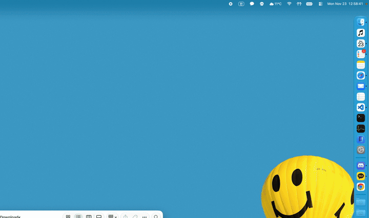

# Liquid Toast

[English](README.md)



음량, 밝기, 재생 키를 누르면 리퀴드 글래스 토스트를 띄우는 macOS 메뉴바 앱입니다. 화면 가운데에 유리 방울이 아이콘을 품고 톡 튀어나왔다가, 메뉴바로 날아가 화면 윗변에 부딪혀 튑니다.

## 기능

- 음량 올리기·내리기, 음소거, 화면 밝기, 키보드 백라이트, 재생·일시정지, 다음 곡, 이전 곡을 누르면 토스트가 뜹니다.
- Dock 자동 가리기가 켜지거나 꺼질 때도 뜹니다 (⌥⌘D든 Dock 메뉴든).
- 직접 정한 단축키: 키 조합과 SF Symbols 아이콘을 고르면, 그 키를 누를 때마다 고른 아이콘이 토스트로 뜹니다. 메뉴의 **단축키 토스트 설정…**(⌘,)에서 정합니다. 아이콘은 시스템 SF Symbols 전체에서 분류와 검색으로 고를 수 있습니다.
- 방울은 살짝 넘쳤다가 자리 잡고, 가장자리에서 작은 방울들이 튀어 나가 잠깐 이어져 있다가 끊어집니다.
- 곡선을 그리며 메뉴바 아이콘으로 날아가 화면 윗변에 부딪힙니다. 화면 가장자리와 이어지는 깔때기 모양으로 퍼지고, 방울 몇 개를 튀기고, 한 방울 떨어뜨린 뒤 스며듭니다.
- 토스트가 떠 있을 때 다시 누르면 처음부터 다시 그리지 않고 이어 갑니다. 방울이 움찔 줄었다가 다시 부풀고 작은 방울이 한 번 더 튑니다. 같은 종류가 날아가던 중이면 다시 돌아오고, 다른 종류면 먼저 것은 끝까지 가고 새 방울이 뜹니다.
- "동작 줄이기"를 켜 두면 날아가지 않고 제자리에서 사라집니다.
- 메뉴는 한국어와 영어를 지원합니다.

## 요구 사항

- macOS 26 이상 (리퀴드 글래스). Apple Silicon Mac의 macOS 27에서만 테스트했습니다.
- Command Line Tools(Swift 6) 또는 Xcode.

## 빌드와 실행

```sh
git clone https://github.com/tansan7271/liquid-toast.git
cd liquid-toast
./setup-signing.sh     # 선택, 한 번만. 다시 빌드해도 권한이 유지되도록 로컬 자체 서명 인증서를 만듭니다.
./build.sh install     # 앱을 빌드해 /Applications로 옮기고 실행합니다.
```

메뉴바에 물방울 아이콘으로 뜹니다. 누르면 메뉴가 열리고, 토스트 켜고 끄기, 미리 보기, 단축키 설정, 로그인할 때 실행을 고를 수 있습니다.

## 권한과 개인정보

- 기능 키와 직접 정한 단축키를 보려면 손쉬운 사용 권한이 필요합니다. 처음 실행할 때 요청하고, 허용하기 전에는 Dock 변화만 알려 줍니다.
- 기능 키는 기능 키 전용 신호와 보조 키(Shift, ⌘ 등)의 눌림만 받습니다. 보조 키는 받는 즉시 버립니다. 기능 키만 요청하면 macOS가 아무것도 보내 주지 않아서 같이 요청합니다.
- 직접 정한 단축키는 일반 키 입력도 받아야 합니다. 이 감시는 단축키가 하나라도 정해져 있을 때만 켜지고, 키를 누를 때마다 정해 둔 단축키와 맞춰 보기만 하고 버립니다. 입력한 내용은 저장하거나 어디로 보내지 않습니다. 키를 가로채지 않아서 쓰던 앱에도 그대로 갑니다.
- macOS가 먼저 처리하는 시스템 단축키(⌥⌘D, 미션 컨트롤 등)는 앱까지 오지 않아서 단축키로 쓸 수 없습니다.
- 음소거 아이콘을 고르려고 출력 장치의 음소거 상태를, Dock 토스트를 위해 Dock 자동 가리기 설정을 읽습니다. 둘 다 권한이 필요 없습니다.
- 네트워크에 연결하지 않습니다. 켜짐·꺼짐 설정과 단축키 목록만 저장합니다.
- `./setup-signing.sh` 없이 빌드하면 임시 서명이 되어, 빌드할 때마다 손쉬운 사용 권한을 다시 허용해야 합니다.

## 비공개 API

macOS가 업데이트되면 동작하지 않을 수 있습니다. 그렇게 되면 유리가 시스템 기본 모양으로 보일 뿐 깨지지는 않습니다.

- 비공개 Core Animation 레이어의 리퀴드 글래스 필터 값: 공개 API보다 유리를 더 맑게, 굴절을 더 강하게 합니다.
- SF Symbols 목록은 시스템 기호 묶음(`CoreGlyphs.bundle`)의 데이터 파일에서 읽습니다(읽기만 합니다). 못 읽으면 자주 쓰는 기호 몇십 개만 보여 줍니다.

## 만든 과정

개인용 메뉴바 유틸리티에서 떼어 낸 기능이고, Claude Code로 만들었습니다. 유리 효과는 [Rainpane](https://github.com/tansan7271/rainpane)의 클릭 물방울을 따랐습니다.

한계:

- 제 Mac에서만 테스트했습니다.
- 유리 값은 제 화면에서 눈으로 보며 맞췄습니다.
- 같은 키에 자기 토스트를 띄우는 다른 앱이 있으면 둘 다 보입니다.

## 라이선스

MIT. [LICENSE](LICENSE)를 보세요.
