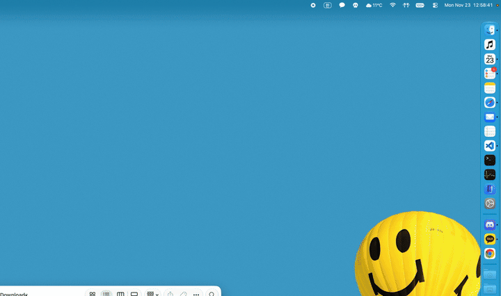

# Liquid Toast

[한국어](README.ko.md)



A macOS menu bar app that shows a Liquid Glass toast when you press the volume, brightness, or media keys. A glass drop pops up in the middle of the screen with an icon, flies into the menu bar, and splashes against the top of the screen.

## Features

- Toasts for volume up/down, mute, display brightness, keyboard backlight, play/pause, next, and previous.
- A toast when the Dock starts or stops hiding (⌥⌘D or the Dock menu).
- Your own shortcuts: pick a key combination and an SF Symbol, and that icon shows as a toast whenever you press it. Set them up in **Shortcut Toasts…** in the menu (⌘,). The picker lists the system's SF Symbols with categories and search.
- The drop pops with a little overshoot, and smaller droplets fly off its edge, stay joined to it for a moment, and break away.
- It flies along a curve into the menu bar icon and splashes against the top of the screen: it spreads into a funnel that blends into the screen edge, throws a few droplets, and drips once before it soaks in.
- Pressing again while a toast is up continues it instead of restarting it. The drop dips and swells again, and throws another round of droplets. If a toast of the same kind is already flying away, it comes back. A different kind lets the first one finish and starts a new drop.
- Respects "Reduce motion": the toast fades in place instead of flying.
- English and Korean menus.

## Requirements

- macOS 26 or later (Liquid Glass). I have only tested it on an Apple Silicon Mac running macOS 27.
- The Command Line Tools (Swift 6) or Xcode.

## Build and run

```sh
git clone https://github.com/tansan7271/liquid-toast.git
cd liquid-toast
./setup-signing.sh     # Optional, once. Creates a local self-signed certificate so the permission survives rebuilds.
./build.sh install     # Builds the app, moves it to /Applications, and opens it.
```

The app lives in the menu bar as a drop icon. Click it for the menu: turn toasts on or off, show a preview, set up your own shortcuts, and open at login.

## Permissions and privacy

- The function keys and your own shortcuts need Accessibility permission. The app asks for it on first launch. Until you allow it, only Dock changes are shown.
- For the function keys, it listens only for the special function key events and for modifier keys (Shift, ⌘, and so on). The modifier keys are thrown away; macOS sends nothing unless they are requested together with the function keys.
- Your own shortcuts need ordinary key presses too. That listener is on only while at least one shortcut is set. Each key press is compared with your shortcuts and thrown away. Nothing you type is stored or sent anywhere. Keys are not intercepted, so they still reach the app you are using.
- System shortcuts that macOS handles first (⌥⌘D, Mission Control, and so on) never reach apps, so they can't be used as shortcuts here.
- It reads the output device's mute state to pick the right mute icon, and the Dock's auto-hide setting. Neither needs permission.
- It makes no network connections. It stores only its on/off setting and your shortcut list.
- If you build without `./setup-signing.sh`, the app is signed ad hoc, and macOS asks for Accessibility permission again after every build.

## Private APIs

These can stop working after a macOS update. If they do, the glass looks like the default system glass. Nothing breaks.

- Liquid Glass filter values on private Core Animation layers: makes the glass clearer and the refraction stronger than the public API allows.
- The SF Symbols list is read from the system's symbol bundle (`CoreGlyphs.bundle`, data files, read only). If it can't be read, the picker shows a short built-in list.

## How it was made

This was split out of a personal menu bar utility and built with Claude Code. The glass effect follows the click drops in [Rainpane](https://github.com/tansan7271/rainpane). The code comments are in Korean.

Limitations:

- I have only tested it on my own Macs.
- The glass tuning was done by eye on my displays.
- If another app also shows its own toasts for the same keys, you will see both.

## License

MIT. See [LICENSE](LICENSE).
